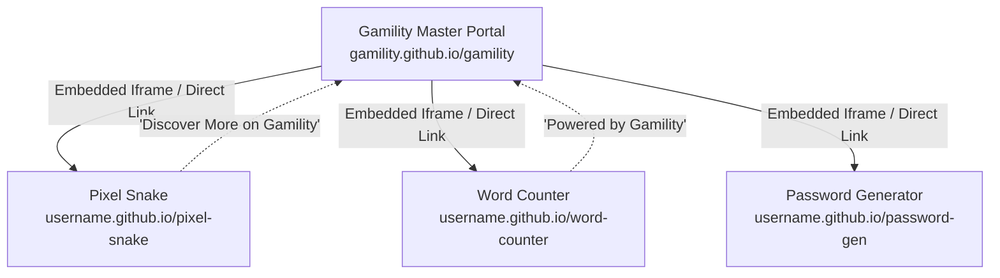

# 🎮 Gamility — Free Web Games & Smart Everyday Utility Tools

<p align="center">
  
</p>

<p align="center">
  <strong>Instant browser-ready HTML5 games and privacy-first productivity utility tools. Zero downloads. Zero installations. 100% Free.</strong>
</p>

<p align="center">
  
  
  
  
  
  
</p>

---

## 🌟 Overview

**Gamility** (a portmanteau of *Games* + *Utility*) is a modern, high-performance static web portal designed to give users instant access to casual web games and essential productivity tools in one clean, distraction-free interface.

Everything is built from scratch with pure **Vanilla HTML5, CSS3, and ES6 JavaScript** — eliminating framework overhead to achieve near-instant page load speeds and 100% client-side privacy.

---

## 🚀 Key Highlights & Features

### 🎮 Free Web Games Hub (`games.html`)
- **12 Curated Games (100% Complete)**: Retro arcade, brain-teasing puzzles, high-speed runners, and tactical board games (*Neon Retro Arcade*, *Galactic Space Shooter*, *Sudoku Master Brain*, *Block Puzzle Rush*, *Cyber Runner 2099*, *Word Twist Mystery*, *Solitaire Classic*, *Pixel Snake Classic*, *Tower Defense Ops*, *Bubble Pop Splash*, *Speed Typist Racer*, and *Chess Tactics Grandmaster*).
- **Instant Category Filtering**: Filter games by *All, Arcade, Puzzle, Action, Casual, and Strategy*.
- **Live Keyword Search**: Filter cards in real-time as you type.
- **In-Browser Player Modal**: Interactive preview player with custom controls guide and full-screen launch options.

### 🛠️ Smart Utility Tools Hub (`tools.html`)
- **12 Practical Daily Utilities**: Word & Character Counter, Cryptographic Password Generator, Instant QR Code Maker, Universal Unit Converter, Color Palette Contrast Checker, Markdown Live Preview, JSON Formatter & Validator, Base64 Encoder, and Unix Epoch Timestamp tool.
- **100% Client-Side Privacy**: All data calculations execute locally in your browser. Zero text, passwords, or images ever leave your device.
- **Interactive Workspace Modal**: Built-in modal playground with real-time text testing.

### 📬 Integrations
- **FormSubmit.co Contact Form**: Connected via encrypted token with background AJAX `fetch()`, anti-spam honeypot (`_honey`), and instant inline success feedback.
- **Google Sheets Newsletter**: Pre-wired to an automated Google Apps Script Web App to log subscriber emails as new rows in a private spreadsheet.

### 🔍 Complete SEO & Social Sharing
- **100% On-Page SEO**: Unique `<title>` tags, descriptive meta descriptions, and `<link rel="canonical">` across all pages.
- **Rich Social Previews**: OpenGraph & Twitter Cards featuring a custom 16:9 cyberpunk social preview image (`og-preview.jpg`).
- **Structured Data**: Schema.org JSON-LD implemented across all pages (`WebSite`, `CollectionPage`, `AboutPage`, `ContactPage`, `WebPage`).
- **Search Engine Directives**: Valid [`robots.txt`](robots.txt) and [`sitemap.xml`](sitemap.xml).
- **Mobile PWA Ready**: Custom SVG favicon and [`site.webmanifest`](site.webmanifest) for "Add to Home Screen" support.

---

## 📁 Directory Structure

```
gamility/
├── index.html                   # Home page (Hero, live search, trending games & tools)
├── games.html                   # Games hub catalog with category tabs & modal player
├── tools.html                   # Utility tools hub catalog with category tabs & workspace
├── about.html                   # Mission, platform facts, core pillars & FAQ accordion
├── contact.html                 # Contact form powered by FormSubmit (AJAX + honeypot)
├── privacy.html                 # Privacy policy & client-side guarantee
├── terms.html                   # Terms of service & permissible usage guidelines
├── 404.html                     # Custom cyberpunk gamified error page
├── robots.txt                   # Search crawler directives
├── sitemap.xml                  # XML search engine sitemap
├── site.webmanifest             # Web App Manifest for mobile installation
├── Website_Creation_Master_Guide.pdf # Printable PDF Web Development Guide
├── assets/
│   ├── css/
│   │   └── styles.css           # Global design system, dark mode & responsive queries
│   ├── js/
│   │   └── main.js              # Navigation, mobile drawer, search filters & API hooks
│   └── images/
│       ├── favicon.svg          # Branded vector gamepad favicon
│       └── og-preview.jpg       # High-resolution social media sharing banner
└── README.md                    # Project documentation
```

---

## 💻 How to Run Locally

Because Gamility is built with pure static web standards, **no build step, compilers, or `npm install` are required**.

### Option A: Double-Click
Simply double-click `index.html` to open and test the site in your default browser (`file:///` protocol).

### Option B: Local Development Server (Recommended)
Using Python:
```bash
# In the project root directory
python -m http.server 8000
```
Or using Node.js:
```bash
npx serve .
```
Then visit `http://localhost:8000` in your web browser.

---

## 🌐 How to Deploy to GitHub Pages (Free Hosting)

1. **Initialize Git & Push to GitHub**:
   ```bash
   git init
   git add .
   git commit -m "Initial launch of Gamility static portal"
   git branch -M main
   git remote add origin https://github.com/<your-username>/gamility.git
   git push -u origin main
   ```

2. **Enable GitHub Pages**:
   - Go to your repository on GitHub.
   - Navigate to **Settings** ➔ **Pages**.
   - Under **Build and deployment**:
     - **Source**: `Deploy from a branch`
     - **Branch**: `main` / `/ (root)`
   - Click **Save**.

3. **Your site is live!**  
   It will be accessible at:  
   `https://<your-username>.github.io/gamility/`

---

## 🛰️ Hub-and-Spoke Architecture (Adding Individual Apps)

Gamility is designed to act as the central master portal for a network of standalone tools and games:



Whenever you build a new standalone repository (e.g. `github.com/<username>/word-counter`), simply add its live link to the card in `tools.html` or `games.html`:
```html
<article class="tool-card" data-url="https://<username>.github.io/word-counter/">
  ...
  <button type="button" class="tool-action-btn btn-tool-trigger">Launch Tool →</button>
</article>
```

---

## 🛡️ Copyright & Terms

- **Code & Platform**: Copyright © 2026 Gamility. All rights reserved. This repository and its source code are proprietary. Unauthorized copying, modification, or redistribution is strictly prohibited.
- **Fonts**: [Outfit](https://fonts.google.com/specimen/Outfit) and [Plus Jakarta Sans](https://fonts.google.com/specimen/Plus+Jakarta+Sans) are licensed under the SIL Open Font License (OFL).
- **Icons & Art**: Bespoke vector SVGs and original game assets. Zero third-party copyrighted materials.

---

<p align="center">
  Built with ❤️ for web gamers and digital creators everywhere.
</p>
